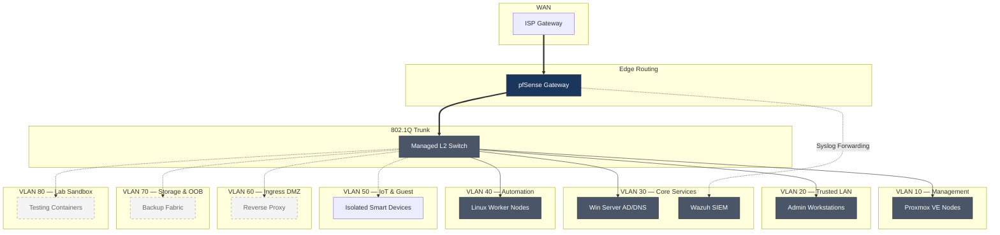

# Home Enterprise Datacenter


> Segmented, default-deny homelab routing fabric for 8-zone 802.1Q isolation with centralized SIEM. Bridges enterprise-class network segmentation (pfSense + managed switch) to a Proxmox VE compute cluster, enabling safe adjacent labs without cross-zone contamination.

## Architecture



> [!IMPORTANT]
> The Proxmox network bridges in VLAN 10 (vmbr0) and VLAN 20 (vmbr1) **must** be bound to separate physical NICs or LACP L2 trunks. A single uplink bridging management and DMZ traffic defeats the isolation this architecture enforces.

## Deployment

### 1. pfSense Base VLAN Configuration

```bash
# Interfaces (assign via Web UI, then verify):
# WAN: 203.0.113.1/24  (sanitized public)
# LAN: 10.0.10.1/24    (VLAN 10)
# OPT1: 10.0.20.1/24   (VLAN 20)

# Firewall rules — default-deny in, allow established + intra-VLAN admin only
pfctl -a "vlan_10_in" -f - <<'EOF'
block in on vtnet0
pass in on vtnet0 proto tcp from 10.0.10.0/24 to 10.0.10.0/24
pass in on vtnet0 proto udp from 10.0.10.0/24 to 10.0.10.0/24
EOF

pfctl -a "vlan_20_in" -f - <<'EOF'
block in on vtnet1
pass in on vtnet1 proto tcp from 10.0.10.0/24 to 10.0.20.0/24 port { 80 443 } keep state
EOF
```

### 2. Proxmox Network Bridges

```bash
# /etc/network/interfaces on each node
auto vmbr0
iface vmbr0 inet static
    address 10.0.10.2/24
    gateway 10.0.10.1
    bridge-ports enp2s0
    bridge-stp off
    bridge-fd 0

auto vmbr1
iface vmbr1 inet static
    address 10.0.20.1/24
    bridge-ports enp3s0
    bridge-stp off
    bridge-fd 0
```

### 3. Wazuh SIEM — Server Deployment

```bash
# Debian 12 VM on Proxmox, VLAN 10
curl -s https://packages.wazuh.com/4.x/wazuh-install.sh | bash -s -- -a
/var/ossec/bin/wazuh-keystore -f root -k <REDACTED_SECRET>

# Register agents on Proxmox hosts and critical VMs
for host in pve-01 pve-02 fw-gateway; do
    ssh "root@${host}.lan" "curl -s https://packages.wazuh.com/4.x/wazuh-agent.sh | bash"
    /var/ossec/bin/manage_agents -a add -i "$host" -I "203.0.113.10"
done
```

> [!WARNING]
> Wazuh agents on pfSense are **not supported upstream**. If you forward syslog from pfSense (System > Advanced > Remote Log Server), ingest those logs via Wazuh's `localfile` syslog input — do not attempt to install the Wazuh agent binary on FreeBSD.

## VLAN Table

| VLAN | Subnet | Purpose | Routing |
|------|--------|---------|---------|
| 10 | 10.0.10.0/24 | Management (Proxmox, pfSense admin) | Admin-IP-only source rules, default-deny out |
| 20 | 10.0.20.0/24 | Trusted LAN (workstations) | Default allow intra-VLAN; default-deny inter-VLAN |
| 30 | 10.0.30.0/24 | Core Services (AD DS/DNS, Wazuh) | Restricted server VLAN, one-way to 10.0.40 |
| 40 | 10.0.40.0/24 | Automation worker nodes | Outbound to WAN via gateway; no inbound from LAN |
| 50 | 10.0.50.0/24 | IoT & Guest | Isolated; WAN-only, no LAN access |
| 60 | 10.0.60.0/24 | Ingress DMZ | WAN->DMZ allowed (stateful); DMZ->LAN blocked |
| 70 | 10.0.70.0/24 | Storage & OOB | Dedicated storage/out-of-band segment |
| 80 | 10.0.80.0/24 | Lab Sandbox | Test containers; no production trust |

## Verification

```bash
# Check pfSense active rules
pfctl -sr

# Validate inter-VLAN isolation (from VLAN 10)
ping -c 1 -W 2 10.0.99.1  # must timeout
ping -c 1 -W 2 10.0.20.1  # must succeed (DMZ inbound established)

# Confirm Wazuh agent connectivity
/var/ossec/bin/agent_control -l
```